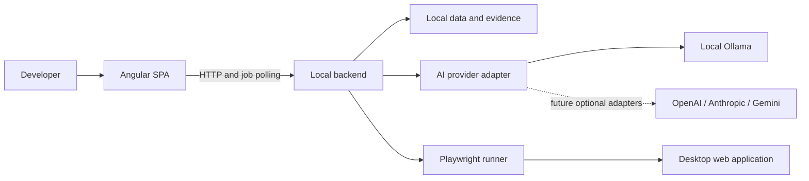

# Frontend architecture

Status: Accepted frontend baseline. Backend implementation details and proposed API shapes still require backend agreement.

## System boundary



This repository owns the frontend only. The backend owns durable Projects/Features, analysis, plans and approvals, AI orchestration, generated Playwright artifacts, execution, evidence, and reports. The frontend requests operations and presents their results; it neither runs generated code nor holds AI credentials.

The local backend is the persistence authority. Reloading the frontend retrieves durable data. Backend unavailability produces an explicit unavailable/error state; browser offline editing, IndexedDB, and synchronization are outside the MVP. Bootstrap itself makes no backend requests.

## Application organization

```text
src/app/
  app.ts, app.html, app.scss     Root shell
  app.config.ts                Application-wide providers
  app.routes.ts                Route composition
  core/                        Future configuration and shared HTTP infrastructure
  shared/                      Future reusable presentation components
  features/
    projects/
    features/
    requirement-analysis/
    qa-plan/
    test-runs/
    qa-report/
```

Only root shell files are created during bootstrap. Introduce `core`, `shared`, and feature directories with actual approved implementation needs; do not commit empty architectural scaffolds.

Features group their pages, feature state, API services, types, and tests together. Lazy-loaded route entrypoints are introduced as features arrive. `shared` must not depend on features; features may use `core` and `shared`. Avoid cross-feature imports of page internals. Put genuinely shared domain concepts in a reviewed shared location only when needed.

## Data flow and state

User interaction → page/form → feature service → local backend → typed result → feature state → view.

Use signals for local synchronous UI state, computed signals for derived state, and RxJS for HTTP and asynchronous composition. Use typed reactive forms for future editing. Start without NgRx or a global store. Keep DTO/presentation mapping outside templates and avoid provider-specific response shapes in components.

Long operations return jobs and are initially observed through polling. Stop polling on terminal states and component teardown. Detailed timing/recovery belongs in feature designs after backend agreement. Test results, execution state, and AI assessment are separate concepts.

## Human approval and provenance

The backend assigns plan revisions and stores human approval for an exact revision. Editing a plan, including enabling or disabling a case, invalidates approval. Generation and execution must identify an approved revision, and the backend must reject stale/unapproved requests. Client UI controls support this rule but cannot be its only enforcement.

Runs retain references to their source Feature, plan revision, generated artifacts, and evidence. Old run records do not silently acquire new plan content. AI-generated assessments cite execution results and available evidence and are labeled as interpretation.

## Runtime and styling

Angular 22.2.3, TypeScript 6, standalone components, strict compiler/template checks, zoneless change detection, Angular Router, and SCSS. Use a client-rendered SPA without SSR. Pin Node 24.19.0 and use npm 11.17.0 with the committed lockfile. See Angular's [compatibility table](https://angular.dev/reference/versions) and [CLI options](https://angular.dev/cli/new).

The shell uses system fonts and local assets. No required external font, CDN, analytics, provider SDK, paid service, or backend is introduced. Future endpoint configuration and proxy setup belong to the first approved integration; no dummy API configuration exists now.

## Testing and delivery

Vitest exercises frontend unit behavior using Angular TestBed. Playwright exercises frontend browser journeys, initially Chromium. These are repository tools; product execution is separately implemented by the backend and uses Playwright only.

Build, lint, formatting, links, unit tests, and browser tests run locally. No remote repository, hosted CI, deployment, or backend scaffolding is part of bootstrap. See [engineering conventions](../conventions/engineering.md) and the [API proposal](api-contracts.md).
